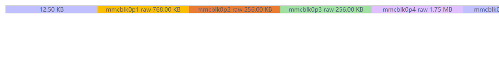
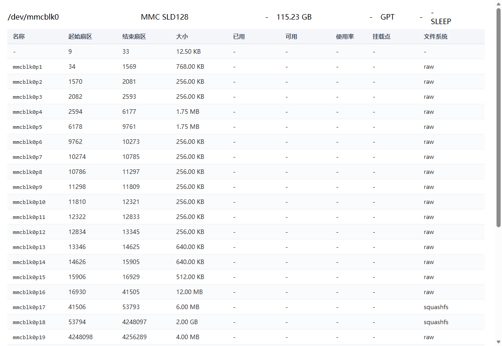

# Luci-app-diskman

[](https://github.com/lisaac/luci-app-diskman/releases)
[](https://github.com/lisaac/luci-app-diskman/stargazers)
[](https://github.com/lisaac/luci-app-diskman/network/members)
[](https://github.com/lisaac/luci-app-diskman/blob/master/LICENSE)
[](https://t.me/joinchat/G5mqjhrlU9S8TMkXeBmj0w)
- A Simple Disk Manager for LuCI, support disk partition and format, support raid / btrfs-raid / btrfs-snapshot
- 一个简单的磁盘管理 LuCI 插件，支持磁盘分区、格式化，支持 RAID / btrfs-raid / btrfs-快照管理
- [Download / 下载 ipk](https://github.com/lisaac/luci-app-diskman/releases)

## 本仓库的修改 / Changes in this fork

> 基于上游 `c20df1d`，本仓库只有一个提交 `d94493e`。`PKG_VERSION` 保持 `0.2.13`，`PKG_RELEASE` 提到 `2`。

### 问题：分区多的时候，后面的分区看不见

磁盘列表里的分区色带是按百分比算宽度的，而且对面积小于 8% 的分区一律强制拉伸到 8%：

```js
if (p <= 8) { expand += 8; part.part_percent = 8 }
```

分区一多，总宽度就远超 100%。以京东云 RE-CS-02（IPQ6018，eMMC 115 GB）为例，`/dev/mmcblk0` 有 28 个分区，加上空闲区间共 31 段，其中 30 段远小于 8%：

- 强制宽度合计：`30 × 8% = 240%`
- 唯一的大分区（`mmcblk0p27`，109 GB）因为缩放系数为负，被浏览器按 0 渲染
- 色带把表格撑到约 2.4 倍宽，页面横向溢出
- 视口里只能看到前几个分区，后面的全部被裁掉



### 修复：改用分区详情页的表格样式

不再画色带，改成带表头、隔行变色、按列对齐的表格：

| 列 | 字段 |
|---|---|
| 名称 | `name` |
| 起始扇区 | `sec_start` |
| 结束扇区 | `sec_end` |
| 大小 | `size_formated` |
| 已用 | `used_formated` |
| 可用 | `free_formated` |
| 使用率 | `usage` |
| 挂载点 | `mount_point` |
| 文件系统 | `fs` |

分区数量再多也能完整显示，不再依赖容器宽度；表头和数据统一左对齐，避免列间错位。磁盘表和 RAID 表共用同一个渲染函数 `dm_parts_table()`，原有的 `sn` / `temp` / `p_table` / `sata_ver` / `health` 填充逻辑保持不变。



### 变更的文件

| 文件 | 说明 |
|---|---|
| `applications/luci-app-diskman/luasrc/view/diskman/disk_info.htm` | 分区渲染从百分比色带改为表格（+145 / −102） |
| `applications/luci-app-diskman/Makefile` | `PKG_RELEASE` 1 → 2 |

### 应用到自己的构建

把 `applications/luci-app-diskman/` 覆盖到你的 feed 里同名包目录，重新编译即可。

只想临时生效，也可以直接替换路由器上的文件：

```sh
scp luci-app-diskman/luasrc/view/diskman/disk_info.htm \
    root@192.168.100.1:/usr/lib/lua/luci/view/diskman/disk_info.htm
```

然后浏览器 `Ctrl + F5` 强制刷新（LuCI 的 `.htm` 视图是每次请求实时读取的，不需要重启 uhttpd）。注意这样改的是 overlay 里的文件，刷固件会被覆盖。

---

## Depends / 依赖
- luci-compat
- [parted](https://github.com/lisaac/luci-app-diskman/blob/master/Parted.Makefile)
- blkid
- smartmontools
- e2fsprogs
- btrfs-progs (Optional)
- lsblk (Optional)
- mdadm (Optional)
    - kmod-md-raid456 (Optional)
    - kmod-md-linear (Optional)

## Compile / 编译
``` bash
mkdir -p package/luci-app-diskman && \
wget https://raw.githubusercontent.com/lisaac/luci-app-diskman/master/applications/luci-app-diskman/Makefile -O package/luci-app-diskman/Makefile
mkdir -p package/parted && \
wget https://raw.githubusercontent.com/lisaac/luci-app-diskman/master/Parted.Makefile -O package/parted/Makefile

#compile package only
make package/luci-app-diskman/compile V=99

#compile
make menuconfig
#choose LuCI ---> 3. Applications  ---> <*> luci-app-diskman..... Disk Manager interface for LuCI ----> save
make V=99

```

## Screenshot / 截图
- Disk Info

- Partitions Info


## Thanks / 谢致
- [luci-app-diskmanager](http://eko.one.pl/forum/viewtopic.php?id=18669)
- [luci-app-smartinfo](https://github.com/animefansxj/luci-app-smartinfo)
- Chinese translation by [锤子](https://www.right.com.cn/forum/space-uid-311750.html)
